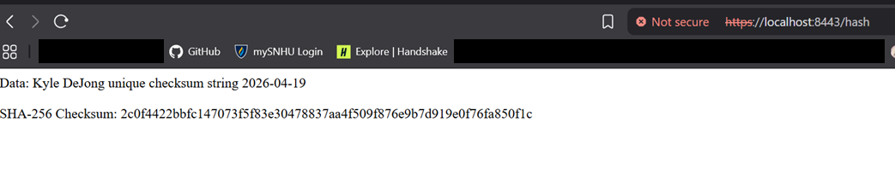

# Java Web Application · Security Case Study

A focused security refactor of a supplied Spring application, covering **SHA-256 checksum generation, local HTTPS, certificate tooling, and dependency review**. The report explains what I changed, how I checked it, and what remained unresolved.

**Read the [security report (PDF)](docs/security-report.pdf)** · [Editable Word version](docs/security-report.docx)

## My contribution

I added a route that returns a fixed string and its SHA-256 digest, generated a self-signed certificate and keystore, and configured the application to serve the route over HTTPS. I then ran the application, inspected its output, and used OWASP Dependency-Check to review the dependencies. AES-256 was part of my recommendation, not a demonstrated implementation.

The useful part of this exercise was working within an existing project and keeping the change controlled. It also required separating confidentiality, checksums, certificate trust, and dependency findings instead of treating them as interchangeable measures of security.

## Evidence at a glance

| Area | What the retained evidence shows |
|---|---|
| Checksum route | A fixed string and its SHA-256 digest at `https://localhost:8443/hash` |
| Certificate setup | Certificate and keystore filenames in the project tree; the browser still shows a trust warning |
| Dependency review | Historical scan with 49 dependencies scanned, 29 unique, 13 vulnerable dependencies, and 160 findings |
| AES-256 | Recommendation in the report; no verified implementation or negotiated cipher suite |

The SHA-256 digest was independently recalculated during portfolio cleanup and matches the visible string. That verifies this input/output pair, not the original Java application's runtime behavior.

Additional original screenshots: [certificate project tree](screenshots/certificate-project-tree.png) · [dependency scan at full resolution](screenshots/dependency-check.png).

## Scope and limitations

This is a **report-based case study**. Application source and a build package are not present, so there are no reproducible run instructions and no fresh application or dependency-scan results. The screenshots date from April 19, 2026.

The dependency scan was not clean and includes high and critical findings. The original work attributed them to older starter dependencies, but no before-and-after evidence establishes that the refactor introduced no vulnerabilities. The case study does not claim remediation or production readiness.

The browser's self-signed certificate warning remains visible. A plain SHA-256 digest returned alongside its input also does not, by itself, authenticate that data or prevent an attacker from replacing both values. These boundaries are explained in the report.

## What I learned

Designing with security in mind before coding begins, during development, and after release helps avoid expensive rework. It was particularly useful to distinguish existing issues from the changes I made. Knowing where my work begins and ends helps focus effort, while documenting inherited problems keeps that limited scope from becoming an excuse to ignore them.

The tools and practices I would carry forward are Java's built-in cryptographic and certificate tooling, dependency review, and testing after meaningful changes. The next technical step would be to review the scan findings, update affected components, and test again. That follow-up is not represented as completed work here.

## Academic context

Prepared for SNHU CS-305 using the supplied Spring starter application and fictional Artemis Financial scenario. The starter application and client scenario are not my original product or a real client engagement.

The portfolio edition removes template instructions, supplied branding, and duplicate console screenshots containing local machine details. The three retained screenshots are unchanged from the original report, including existing blacked-out browser areas. No private keys, keystore, or original repository history were imported. AI assistance was used to clean the presentation, correct technical overclaims, and add references. The original school submission is preserved separately.

## References

- [NIST FIPS 197 — AES](https://csrc.nist.gov/pubs/fips/197/final)
- [Oracle Java SE 11 — MessageDigest](https://docs.oracle.com/en/java/javase/11/docs/api/java.base/java/security/MessageDigest.html)
- [Oracle Java SE 11 — keytool](https://docs.oracle.com/en/java/javase/11/tools/keytool.html)
- [OWASP — Transport Layer Security](https://cheatsheetseries.owasp.org/cheatsheets/Transport_Layer_Security_Cheat_Sheet.html)
- [OWASP — Dependency-Check](https://owasp.org/projects/dependency-check)
